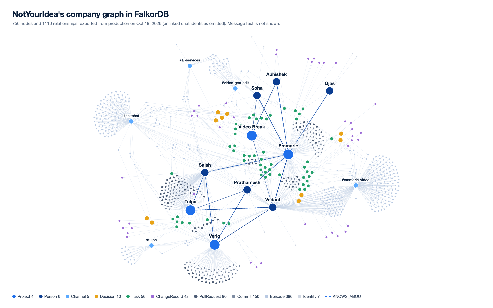
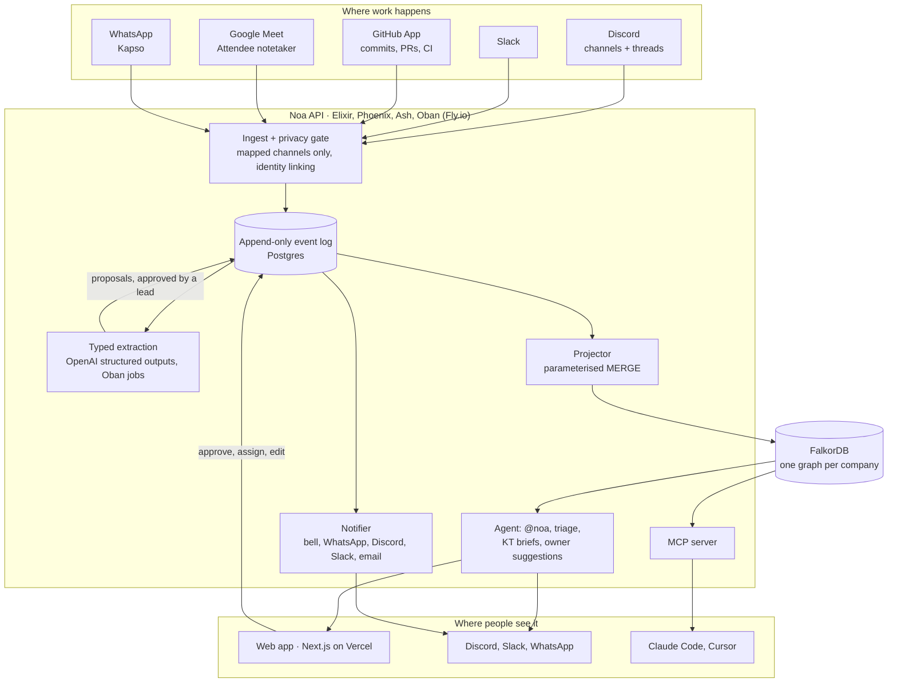
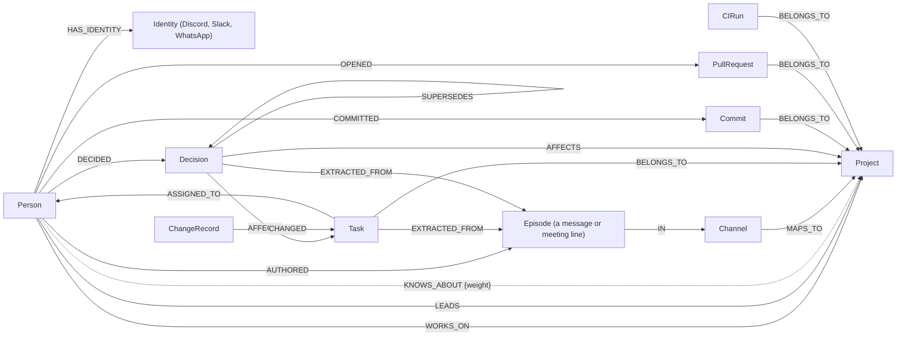
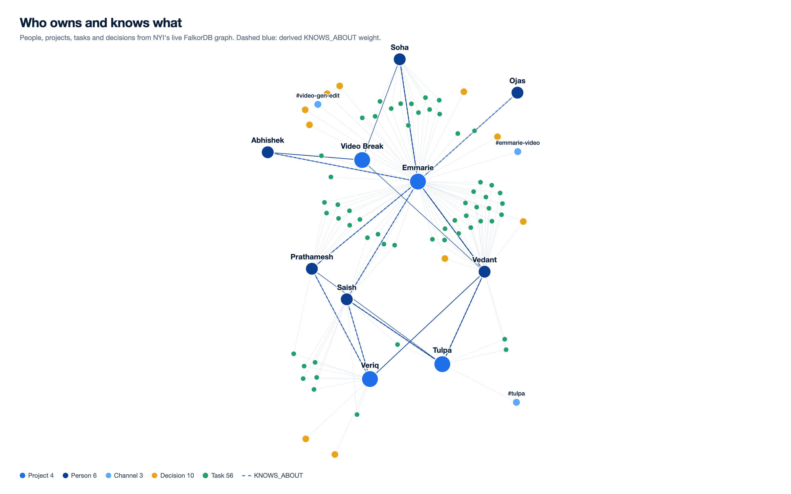

# Noa

**A company brain that turns team conversations into managed work, built on FalkorDB.**

Noa reads where a team already works (Discord threads, Slack, GitHub, Google Meet and WhatsApp) and keeps people, projects, tasks, owners, deadlines and decisions in one [FalkorDB](https://www.falkordb.com/) graph per company. Leads approve what Noa proposes, boards update themselves, everyone gets their day on the web, on WhatsApp and inside their coding agent, and every answer cites the message it came from and the graph route that found it.

NotYourIdea (NYI) runs four products with a small team that moves between them. We built Noa during the hackathon, and NYI's real work has run through it since.

| | |
| --- | --- |
| **Live app** | [app.heynoa.xyz](https://app.heynoa.xyz) (invite-only workspaces) · site: [heynoa.xyz](https://heynoa.xyz) |
| **Demo video** | https://www.youtube.com/watch?v=djpEx_QtBUI |
| **Track** | **03 Company Brain** |
| **Hackathon** | [Graph Hacks: Context for AI Agents](https://www.wemakedevs.org/hackathons/falkordb), WeMakeDevs × FalkorDB, Oct 15–18, 2026 |
| **Team** | NotYourIdea: Saish, Soha, Vedant |



<sub>NYI's production graph, exported from FalkorDB on Oct 19, 2026 and rendered with [`docs/images/render-graph.js`](docs/images/render-graph.js). Big dots are people and projects; the clusters are the messages, commits and PRs behind them. Message text is not shown.</sub>

## Contents

- [What Noa does](#what-noa-does)
- [Architecture](#architecture)
- [The graph data model](#the-graph-data-model)
- [Cypher and graph algorithms the product depends on](#cypher-and-graph-algorithms-the-product-depends-on)
- [Why FalkorDB is central](#why-falkordb-is-central)
- [Submission checklist](#submission-checklist)
- [Run it locally](#run-it-locally)
- [Deployment](#deployment)
- [Stack](#stack)
- [Privacy and data](#privacy-and-data)
- [AI tools disclosure](#ai-tools-disclosure)

## What Noa does

**For a lead**

- **Chat becomes work.** Messages, threads and meeting transcripts become proposed tasks, status changes, deadlines and decisions. Noa routes each one to a project by channel and names the person who was asked, not the person who asked. Proposals wait in an Inbox for one-click approval, each quoting its source.
- **Boards that stay current.** Kanban (filter by this week, last 15 days or all), timeline, project overview and a Portfolio with health, workload and risks.
- **"Who should own this?"** Every task can rank owners from the graph: who worked on the project, who finished similar work and who has room, with the graph route behind each reason. A triage agent finds work nobody is carrying.
- **Governance.** Every change to a shared field is a change record. Members' deadline and scope changes wait for the lead, and any change can be reverted.
- **Staffing and shifts.** Drag a person to another project. Noa moves the allocation, hands over their tasks, routes questions to the previous owner and writes a knowledge-transfer brief.

**For a member**

- **My day.** Open tasks across every project, with deadlines, what's waiting on you and what was decided today.
- **WhatsApp.** "Vedant put you on … due Friday", with **Start now / Done / Need help** buttons that act on the board. Reply **tasks** for your list. When you finish, your lead hears about it.
- **Agent packs and MCP.** `CLAUDE.md`, `AGENTS.md` and `tasks.md` for every project you're on, written from the graph, plus an MCP server so Claude Code or Cursor can read and update your work.

**For everyone**

- **`@noa` anywhere.** Ask in the web app, Discord (`/noa ask`), Slack or WhatsApp. Answers carry numbered citations and the graph route behind each one.
- **Meeting minutes.** A visible Google Meet notetaker (via Attendee) or Discord voice, used only with everyone's consent. Minutes skip the small talk, and commitments and decisions land in the Inbox for approval, never automatically.

## Architecture



1. **Ingest.** Connectors only read channels an admin has mapped to a project. DMs are never ingested, and chat history is limited to the last 30 days, because old chat isn't new work.
2. **Event log.** Every message and every change to work is an append-only event in Postgres, written in the same transaction as the change. Postgres also holds accounts, roles and permissions.
3. **Extraction.** An Oban job per channel sends recent messages, with their thread context, to a model that must return strict typed JSON (tasks, status changes, deadlines, decisions, scope changes). Each item is validated and must cite the message it came from.
4. **Projection.** The projector writes each event into the company's FalkorDB graph with parameterised `MERGE`s, within seconds of the commit. The graph can be dropped and replayed from the log at any time (`mix noa.graph`).
5. **Reads go through the graph.** `@noa`, owner suggestions, triage, KT briefs, agent packs, the MCP tools, Portfolio insights and the Graph tab all query FalkorDB.

## The graph data model

Each company gets its own FalkorDB graph, `noa_<org id without dashes>`, so one company's knowledge is isolated from another's and can be rebuilt on its own. Schema details: [docs/schema.md](docs/schema.md).



| Node | What it is | Key properties |
| --- | --- | --- |
| `Person` | Someone in the org map | `name`, `title`, `handles` |
| `Project` | A product or client project | `name`, `key`, `repo`, `aliases` |
| `Channel` | A Discord or Slack channel Noa may read | `name`, `platform`, `read` |
| `Episode` | One message or meeting utterance: the evidence | `text` (full-text indexed), `at`, `author`, `platform` |
| `Task` | Work, with its owner and deadline | `title` (full-text), `status`, `due` |
| `Decision` | What was decided, until superseded | `statement` (full-text), `kind`, `status` |
| `ChangeRecord` | A change to a task's date, scope or owner, and whether the lead approved it | `kind`, `old`, `new`, `status`, `reason` |
| `Commit`, `PullRequest`, `CIRun` | GitHub activity per project | `message` / `title` (full-text), `state`, `url` |
| `Identity` | A chat account linked to a person | `platform`, `external_id`, `name` |

- **Every `Task` and `Decision` has an `EXTRACTED_FROM` edge** to the message it came from. That edge is how every answer cites its source.
- **`KNOWS_ABOUT` is derived.** It is recomputed from the graph itself (below), never written by hand.
- **Indexes.** Every label has a range index and a unique constraint on `id`, so replays can't create duplicates. Episodes, task titles and decision statements also have full-text indexes.

### The live graph

NYI's production graph on Oct 19, 2026 has **797 nodes** (386 episodes, 150 commits, 90 pull requests, 56 tasks, 48 identities, 42 change records, 10 decisions, 6 people, 5 channels, 4 projects) and **1,110 relationships** (`IN` 386, `BELONGS_TO` 296, `AUTHORED` 97, `EXTRACTED_FROM` 66, `COMMITTED` 60, `OPENED` 58, `ASSIGNED_TO` 51, `CHANGED` 42, `WORKS_ON` 18, `KNOWS_ABOUT` 10, `AFFECTS` 10, `HAS_IDENTITY` 7, `LEADS` 4, `MAPS_TO` 3, `DECIDED` 2).

The same graph, with only people, projects, tasks and decisions. The dashed lines are the derived `KNOWS_ABOUT` edges that "Who should own this?", KT briefs and the MCP tool `who_knows` read:



In the app, each project's **Graph** tab shows its FalkorDB neighbourhood. Click two nodes to highlight the shortest path between them.

## Cypher and graph algorithms the product depends on

These come from the code; each says where it runs.

### Who knows what: weighted `KNOWS_ABOUT`

`api/lib/noa/graph/experts.ex`. Weights are summed from what the graph shows each person did on a project: finished tasks and active decisions ×3, merged PRs ×2, and open tasks, messages in the project's channels and commits ×1 each. This is one of the six passes:

```cypher
MATCH (x:Person)<-[:ASSIGNED_TO]-(t:Task {status: 'done'})-[:BELONGS_TO]->(p:Project)
WITH x, p, count(*) AS n
MERGE (x)-[k:KNOWS_ABOUT]->(p)
SET k.weight = coalesce(k.weight, 0) + n * $w
```

Used by "Who should own this?", the triage agent, KT briefs ("people to meet"), agent packs and the MCP tools `who_knows` and `suggest_owner`. A project where one person holds most of the `KNOWS_ABOUT` weight is flagged in Portfolio as a bus-factor risk.

### Who the work runs through, and who connects teams

Portfolio and `@noa`, `api/lib/noa/graph/experts.ex`:

```cypher
CALL algo.pageRank(NULL, NULL) YIELD node, score
WITH node, score WHERE node:Person
RETURN node.name AS name, score ORDER BY score DESC LIMIT 3
```

```cypher
CALL algo.betweenness({nodeLabels: ['Person', 'Project', 'Task'],
  relationshipTypes: ['ASSIGNED_TO', 'BELONGS_TO', 'WORKS_ON', 'LEADS']})
YIELD node, score WITH node, score WHERE node:Person AND score > 0
RETURN node.name AS name, score ORDER BY score DESC LIMIT 3
```

Working groups come from `algo.WCC` (connected components) over `WORKS_ON` and `LEADS`.

### Retrieval for `@noa`

`api/lib/noa/agent/graph.ex`. Full-text search over the graph finds the messages, tasks and decisions a question mentions, then walks out to their channel, project and source:

```cypher
CALL db.idx.fulltext.queryNodes('Episode', $q) YIELD node AS e
OPTIONAL MATCH (e)-[:IN]->(c:Channel)
OPTIONAL MATCH (c)-[:MAPS_TO]->(p:Project)
RETURN e, p
```

The agent also walks from the projects and people a question names (tasks → `EXTRACTED_FROM` → episodes → authors; decisions → `AFFECTS`), and calls PageRank, betweenness and paths as tools. Each answer lists the graph route behind every source.

### How two things are connected

`api/lib/noa/graph/view.ex`, used by the Graph tab, `@noa` and the MCP tool `how_connected`. FalkorDB has no undirected `shortestPath`, so this is a bounded variable-length match ordered by length:

```cypher
MATCH p = (a {id: $from})-[*1..5]-(b {id: $to})
RETURN length(p) AS hops, [n IN nodes(p) | n.id] AS ids
ORDER BY hops
LIMIT 1
```

### Context for coding agents

`api/lib/noa/packs.ex` and `api/lib/noa/mcp/tools.ex`. Agent packs read the project's subgraph: people and experts, decisions with sources, open work and recent GitHub changes. The MCP server exposes graph queries as tools: `project_context`, `my_tasks`, `ask`, `who_knows`, `how_connected`, `suggest_owner`, `assign_task`, `update_task_status`, `triage`, `risks`, `kt_brief` and `list_projects`. Setup: [docs/mcp.md](docs/mcp.md).

How each FalkorDB feature maps to the code: [docs/hackathon.md](docs/hackathon.md).

## Why FalkorDB is central

The rules ask that the product not still work with FalkorDB removed. Without the graph, Noa loses:

- **Who should own this?** and the triage agent: both rank people by walking `WORKS_ON`, `KNOWS_ABOUT`, finished tasks and decisions.
- **Expertise and risk:** `KNOWS_ABOUT`, PageRank, betweenness, working groups and bus factor. These exist only as graph computations.
- **Paths and the Graph tab:** how a person, task and decision connect.
- **KT briefs and agent packs:** their "people to meet", decisions and context come from the project subgraph.
- **The MCP tools** that coding agents use: `who_knows`, `how_connected`, `suggest_owner`, `project_context`, `triage` and `risks`.
- **Graph-routed answers:** `@noa` retrieves from the graph and shows its route. If FalkorDB is down, it falls back to a plain keyword list from Postgres, with no routes, experts or paths.

Postgres stays the system of record for accounts, permissions and the event log, so the graph can always be rebuilt. Every read that makes Noa a brain rather than a tracker goes through FalkorDB.

## Submission checklist

| The rules ask for | Where |
| --- | --- |
| A public source-code repository | This repo, [github.com/SohaKhare/Noa](https://github.com/SohaKhare/Noa) |
| A README with setup instructions and the graph data model | [Run it locally](#run-it-locally) and [The graph data model](#the-graph-data-model) |
| The Cypher queries or graph algorithms the product depends on | [Cypher and graph algorithms](#cypher-and-graph-algorithms-the-product-depends-on) and [docs/hackathon.md](docs/hackathon.md) |
| A demo video of the working project | _link to be added_ |
| A live deployment | [app.heynoa.xyz](https://app.heynoa.xyz), API at `api.heynoa.xyz`, both on NYI's real workspace |
| The track | 03 Company Brain |
| FalkorDB as the primary graph database, doing real work | [Why FalkorDB is central](#why-falkordb-is-central) |
| New work during the event | The repo and all FalkorDB code were written Oct 15–18, 2026. Tulpa v1, NYI's earlier product, contributed patterns only and never used FalkorDB. |
| Data you're allowed to use | NYI's own team chat, repos and meetings, from channels the team opted in. See [Privacy and data](#privacy-and-data). |
| AI assistance disclosed | [AI tools disclosure](#ai-tools-disclosure) |

## Run it locally

You need Docker, Elixir 1.18+ (OTP 27+), Node 22+ and pnpm.

```bash
git clone https://github.com/SohaKhare/Noa.git && cd Noa

docker compose up -d postgres                 # Postgres 17
docker compose --profile graph up -d          # FalkorDB 4.10 on :6379

cd api
mix setup                                     # deps, database, migrations
mix noa.superadmin you@company.com --name "You"
mix phx.server                                # API on http://localhost:4000, dev mailbox at /dev/mailbox
```

In another terminal, start the web app:

```bash
pnpm install
pnpm dev:web                                  # app on http://localhost:3000
pnpm dev:landing                              # marketing site on http://localhost:3001 (optional)
```

Sign in at http://localhost:3000 as the superadmin, create a workspace in the console and accept its invite. Then load an org map with sample work and build the graph:

```bash
cd api
mix noa.seed --sample                         # NYI's org map plus sample tasks and proposals (dev only)
mix noa.graph                                 # rebuild the workspace graph from the event log
```

Open a project's **Graph** tab, Portfolio, or **Ask Noa** to see the graph at work.

**Optional keys** (in `api/.env`; see `deploy/prod.env.example`):

| Key | Enables |
| --- | --- |
| `OPENAI_API_KEY` | Extraction and model-written `@noa` answers. Without it, extraction waits and `@noa` answers with a cited list. |
| `DISCORD_BOT_TOKEN` | Discord ingest, `/noa` commands and DMs ([docs/discord.md](docs/discord.md)) |
| `KAPSO_API_KEY` | WhatsApp ([docs/whatsapp.md](docs/whatsapp.md)). Without it, messages stay in a local outbox. |
| `ATTENDEE_API_KEY` | Google Meet notetaker ([docs/meet-integration.md](docs/meet-integration.md)) |
| GitHub App and Slack app credentials | [docs/github.md](docs/github.md), [docs/slack.md](docs/slack.md) |

Tests: `cd api && mix test` (252 tests, including permission-leak tests on every route).

## Deployment

Production runs on Fly.io in Singapore: `heynoa-api` (Phoenix release), `heynoa-graph` (FalkorDB `falkordb/falkordb:v4.10.3` on Fly's private network) and `heynoa-db` (Postgres). The web app runs on Vercel at `app.heynoa.xyz`, and the landing page at `heynoa.xyz`. The same images also run on one server with Docker Compose and Caddy. Full guide: [docs/deploy.md](docs/deploy.md).

## Stack

| Layer | Choice |
| --- | --- |
| Graph | FalkorDB 4.10, via the official [`falkordb`](https://hex.pm/packages/falkordb) Hex client |
| Backend | Elixir, Phoenix, Ash 3 (AshPostgres, AshAuthentication, policies), Oban |
| AI | OpenAI structured outputs through InstructorLite; MCP server for coding agents |
| Frontend | Next.js for the app (`web/`) and the site (`landing/`), Tailwind v4, Motion, dnd-kit |
| Connectors | Discord (Nostrum, including consented voice minutes), Slack Events API, GitHub App, Google Meet via [Attendee](https://attendee.dev), WhatsApp via [Kapso](https://kapso.com/), Gmail (opt-in) |
| Ops | Fly.io, Vercel, Postgres, GitHub Actions |

| Path | What |
| --- | --- |
| `api/` | Phoenix + Ash backend: accounts, workspaces, work, event log, graph, extraction, agent, connectors, MCP. [api/README.md](api/README.md) |
| `web/` | Next.js app: My day, Inbox, project board / timeline / decisions / graph / KT, Portfolio, People, Ask Noa, Settings |
| `landing/` | Marketing site |
| `docs/` | [schema](docs/schema.md), [extraction](docs/extraction.md), [memory](docs/memory.md), [auth](docs/auth.md), [security](docs/security.md), [MCP](docs/mcp.md), [WhatsApp](docs/whatsapp.md), [Discord](docs/discord.md), [meetings](docs/meetings.md), [deploy](docs/deploy.md), [demo plan](docs/demo.md), [hackathon compliance](docs/hackathon.md) |

### Roles

| Role | Lands on | Can do |
| --- | --- | --- |
| Superadmin | Platform console | Workspaces, connectors, jobs |
| Org admin | Onboarding | Sources, channel-to-project mapping, people, roles |
| PM / lead | Portfolio | Boards, approvals, timeline, shifts, staffing |
| Member | My day | Own tasks, approvals, `@noa` |
| Guest | One project | Read-only timeline and decisions |

## Privacy and data

- **Our own data.** The graph holds NYI's own workspace: our team chat, our repositories and our meetings. Nothing private, paywalled or third-party is loaded.
- **Opt-in sources.** Noa reads only channels an admin has mapped. DMs are never ingested; a DM to Noa is answered and then discarded.
- **Consented meetings.** The organizer must confirm that everyone consented before the visible notetaker joins.
- **One graph per company.** Every query is scoped to the caller's workspace and permissions, and each route has a permission-leak test.
- **No secrets in packs.** Agent packs never contain secrets, and credentials live only in deployment secrets.

More: [docs/security.md](docs/security.md).

## AI tools disclosure

As the rules require, we disclose that we used AI coding assistants (Anthropic's Claude Code and OpenAI's Codex) to write and review code, tests and docs. The team designed the product, the graph model and the queries, verified the work (252 tests, plus running it on our own workspace) and can explain each part. Our reasoning is written down in `docs/` and `PLAN.md`.

Inside the product, Noa uses OpenAI models for extraction and for writing `@noa` answers. The graph decides what the model reads, and every extracted item is validated against a typed schema before it reaches the graph.

## Team

**BayalisLabs**: Saish, Soha, Vedant.
