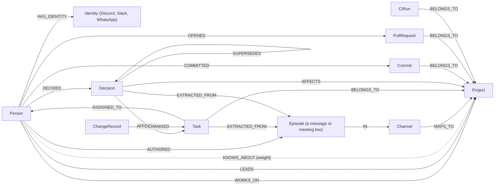

# Noa

**A company brain that turns team conversations into managed work.**

Noa reads Discord, Slack, Google Meet and WhatsApp. It keeps tasks, owners, deadlines and decisions in one [FalkorDB](https://www.falkordb.com/) graph per company, and answers questions with sources. PMs get boards that update themselves, members get one list across all their projects, and people moving between projects get a knowledge-transfer (KT) brief and an agent-ready context pack.

Built by team **NotYourIdea** for [Graph Hacks: Context for AI Agents](https://www.wemakedevs.org/hackathons/falkordb) (WeMakeDevs × FalkorDB, Oct 15–18, 2026), Company Brain track. Noa is built to run NYI's real projects, not as a demo.

> Status (Oct 17): the work loop, shifts and KT run end to end on NYI's data in the web app. Chat intake from Discord and WhatsApp is being wired. See [What works today](#what-works-today).

## What it does

- **Chat to tasks.** Messages and meeting transcripts become proposed tasks, status changes, deadlines and decisions, routed to the right project. Confident updates apply with undo; the rest wait in a one-click approval inbox.
- **Boards that stay current.** Kanban, Gantt timeline, My day, and a portfolio view with project health, workload and risks.
- **Decided today.** A per-project and per-person panel of decisions, each linked to the message it came from.
- **Shared edits with oversight.** Anyone involved can edit a shared item; scope and deadline changes notify, or wait for, the person they report to.
- **`@noa` everywhere.** Ask in Discord, Slack, WhatsApp or the web app and get cited, permission-aware answers.
- **Shifts and KT.** Drag a person to another project. Noa drafts the handover, suggests new owners, routes questions to the previous owner, and sends a KT brief.
- **Agent context packs.** People joining a project get `CLAUDE.md` / `AGENTS.md`, `tasks.md` and an `.mcp.json` snippet generated from the graph. Non-dev roles get their own pack: `brief.md`, `client.md`, `runbook.md` or `project-state.md`. Secrets never go in these files; they are delivered through one-time, logged links.
- **MCP server.** Coding agents (Claude Code, Cursor) connect to Noa for live, per-person, per-project context.

## How it works

```
Slack · Discord · Google Meet · WhatsApp (Kapso) · GitHub
                    │
        Ingest + bots (privacy gate, identity)
                    │
        Append-only event log (Postgres)
                    │
     Typed extraction (strict JSON schema, async jobs)
                    │
     FalkorDB: one graph per company
     Person · Project · Task · Decision · Episode
     full-text + range indexes · PageRank · paths
                    │
   Work API · Notifier · Agent (@noa, KT) · MCP server
                    │
        Web app · chat surfaces · coding agents
```

- FalkorDB is the knowledge store: every `@noa` answer, expert lookup, KT brief, path and portfolio insight is a graph query. Postgres keeps accounts, permissions and the append-only event log the graph is built from, so the graph can always be rebuilt.
- Every extracted item is a typed schema validated before it reaches the graph, and every item cites its source message.
- Graph algorithms do the product work: weighted `KNOWS_ABOUT` edges, PageRank, betweenness and connected components find experts, the people work runs through, the bridges between projects, working groups and bus-factor risks. `@noa` walks the graph from what you ask about, searches full-text indexes over messages, tasks and decisions, and shows the graph route behind every source. How each FalkorDB feature is used, and how Noa meets the hackathon rules: [docs/hackathon.md](docs/hackathon.md).

## The graph

Each company gets its own FalkorDB graph (`noa_<org id without dashes>`). The projector (`api/lib/noa/graph/projector.ex`) writes it from the event log with parameterised `MERGE`s, so it can be dropped and replayed at any time (`mix noa.graph`).



| Node | What it is | Key properties |
| --- | --- | --- |
| `Person` | Someone in the org map | `name`, `title`, `handles` |
| `Project` | A product or client project | `name`, `key`, `repo`, `aliases` |
| `Channel` | A Discord/Slack channel Noa may read | `name`, `platform`, `read` |
| `Episode` | One message or meeting utterance: the evidence | `text` (full-text indexed), `at`, `author`, `platform` |
| `Task` | Work, with its owner and deadline | `title` (full-text), `status`, `due` |
| `Decision` | What was decided, until superseded | `statement` (full-text), `kind`, `status` |
| `ChangeRecord` | A change to a task's date, scope or owner, and whether the lead approved it | `kind`, `old`, `new`, `status`, `reason` |
| `Commit`, `PullRequest`, `CIRun` | GitHub activity per project | `message` / `title` (full-text), `state`, `url` |
| `Identity` | A chat account linked to a person | `platform`, `external_id`, `name` |

Every `Task` and `Decision` has an `EXTRACTED_FROM` edge to the message it came from, which is how every answer cites its source. `KNOWS_ABOUT` is derived: rebuilt from the graph itself (below), never written by hand.

NYI's production graph on Oct 18, 2026: 363 episodes, 150 commits, 90 pull requests, 51 tasks, 32 change records, 10 decisions, 6 people, 4 projects; 1,046 relationships (`IN` 363, `BELONGS_TO` 291, `AUTHORED` 84, `EXTRACTED_FROM` 61, `COMMITTED` 60, `OPENED` 58, `ASSIGNED_TO` 44, `CHANGED` 32, `WORKS_ON` 18, `KNOWS_ABOUT` 10, `AFFECTS` 10).

### The graph doing the work

These are the queries the product depends on, from the code.

**Who knows what** (`api/lib/noa/graph/experts.ex`). `KNOWS_ABOUT` weights are summed from what the graph shows each person did on a project: finished tasks ×3, active decisions ×3, merged PRs ×2, open tasks, messages in its channels and commits ×1 each. One of the six passes:

```cypher
MATCH (x:Person)<-[:ASSIGNED_TO]-(t:Task {status: 'done'})-[:BELONGS_TO]->(p:Project)
WITH x, p, count(*) AS n
MERGE (x)-[k:KNOWS_ABOUT]->(p)
SET k.weight = coalesce(k.weight, 0) + n * $w
```

Used by "Who should own this?", the triage agent, KT briefs ("people to meet"), agent packs and the MCP tools `who_knows` and `suggest_owner`.

**Who the work runs through, and who connects teams** (Portfolio, `@noa`):

```cypher
CALL algo.pageRank(NULL, NULL) YIELD node, score
WITH node, score WHERE node:Person
RETURN node.name AS name, score ORDER BY score DESC LIMIT 3
```

```cypher
CALL algo.betweenness({nodeLabels: ['Person', 'Project', 'Task'],
  relationshipTypes: ['ASSIGNED_TO', 'BELONGS_TO', 'WORKS_ON', 'LEADS']})
YIELD node, score WITH node, score WHERE node:Person AND score > 0
RETURN node.name AS name, score ORDER BY score DESC LIMIT 3
```

Working groups come from `algo.WCC` over `WORKS_ON`/`LEADS`; bus-factor risk is a project where one person holds most of the `KNOWS_ABOUT` weight.

**Retrieval for `@noa`** (`api/lib/noa/agent/graph.ex`). A question is answered from the graph: full-text search finds the messages, tasks and decisions it mentions, then walks out to their project and source:

```cypher
CALL db.idx.fulltext.queryNodes('Episode', $q) YIELD node AS e
OPTIONAL MATCH (e)-[:IN]->(c:Channel)
OPTIONAL MATCH (c)-[:MAPS_TO]->(p:Project)
RETURN e, p
```

"How is Saish connected to Emmarie?" runs a bounded path search, `MATCH p = (a {id: $a})-[*1..5]-(b {id: $b})`, shortest first; the Graph tab highlights the same path. Each answer lists the graph route behind every source, so you can see the graph did the work. Postgres is only a fallback when the graph is down or not built yet.

More on each FalkorDB feature and the hackathon rules: [docs/hackathon.md](docs/hackathon.md). Full schema and constraints: [docs/schema.md](docs/schema.md).

## Stack

| Layer | Choice |
| --- | --- |
| Backend | Elixir, Phoenix, Ash 3 (AshPostgres, AshAuthentication, policies), Oban |
| Graph | FalkorDB Cloud via the official [`falkordb`](https://hex.pm/packages/falkordb) Hex client |
| AI | OpenAI Structured Outputs through InstructorLite; `ash_ai` for agent tools and MCP |
| Frontend | Next.js 16 for the app (`web/`) and the marketing site (`landing/`), Tailwind v4, Motion, dnd-kit, `ash_typescript` RPC client, Phoenix Channels |
| Connectors | Discord (Nostrum, including consented voice minutes), visible Google Meet bot via Attendee (manual transcript fetch; see [setup](docs/meet-integration.md)), Slack Events API, WhatsApp via [Kapso](https://kapso.com/) |
| Ops | Fly.io, Postgres, Logfire / OpenTelemetry, Sentry, GitHub Actions |

## Roles

| Role | Lands on | Can do |
| --- | --- | --- |
| Superadmin | Platform console | Orgs, connectors, jobs, LLM spend |
| Org admin | Onboarding | Sources, channel-to-project mapping, people, roles |
| PM / lead | Portfolio | Boards, approvals, timeline, shifts, staffing, credentials |
| Member | My day | Own tasks, approvals, `@noa` |
| Guest | One project | Read-only timeline and decisions |

## What works today

Everything below runs locally against real Postgres and FalkorDB, with tests (`cd api && mix test`, 140 tests including permission-leak tests on every route).

| Area | Working | Notes |
| --- | --- | --- |
| Accounts and workspaces | Yes | Invite-only sign-in (password or magic link), roles, superadmin console, people and invites. [docs/auth.md](docs/auth.md) |
| Org map and onboarding | Yes | Set up a workspace in the app (`/onboarding`): projects, people (including everyone who joined), who works where, channels listed from connected Discord and Slack workspaces, or import an org map JSON. Mapping also in Settings |
| Event log | Yes | Every write to work is an append-only event in the same transaction; chat messages are recorded once |
| Graph | Yes | One FalkorDB graph per workspace, kept in step by a projector and rebuildable from the log (`mix noa.graph`) |
| Chat to proposals | Yes, with a model key | Typed extraction (tasks, status, deadlines, decisions, scope) with routing, run by an Oban job per channel. Needs `OPENAI_API_KEY` |
| Inbox | Yes | Approve, edit and dismiss; duplicates flagged; confident items apply themselves with Undo |
| Boards | Yes | Kanban with drag and drop, read-only timeline, project overview, Projects list, Portfolio |
| My day | Yes | Your open tasks by project or date, what waits on you, blocked work, decided today |
| Decisions | Yes | Approved decisions with sources; a newer decision supersedes an older one |
| Change records and lead approval | Yes | Every edit to a shared field is recorded; members' deadline and scope changes wait for a lead; other edits can be reverted |
| `@noa` | Yes | Answers from the FalkorDB graph (walks, full-text, PageRank, betweenness, paths) with numbered citations and the route that found each; model-written with a key, a plain cited list without |
| Shifts | Yes | Drag someone on the staffing board; Noa moves the allocation, hands over tasks and routes questions to them for two weeks |
| KT brief and experts | Yes | Per-project brief with people to meet from the graph (download as `brief.md`); PageRank and bus factor in Portfolio |
| Graph view | Yes | Each project's FalkorDB neighbourhood; click two nodes to see the shortest path between them |
| Discord | Yes, after server connection and verified account linking | Mapped-channel ingest/backfill, `/noa` private cited replies, task/approval buttons, recaps, KT briefs and notification DMs. Explicit DM questions are answered but never ingested. [docs/discord.md](docs/discord.md) |
| Slack | Yes, once the app is configured | Per-workspace OAuth, signed Events API ingest of mapped member channels, edits/deletes, user sync, 15-message backfill, and DM notifications. [docs/slack.md](docs/slack.md) |
| Gmail inbox | Opt-in | Read-only IMAP poll of new mail in a configured workspace's INBOX; plain-text content enters the event log and extraction. See [docs/gmail.md](docs/gmail.md) |
| WhatsApp | Yes, sends once Kapso is configured | Signed webhooks, reply buttons, "done" moves a card, shift links to the brief and pack. Without credentials, messages stay in a local outbox. [docs/whatsapp.md](docs/whatsapp.md) |
| Agent pack | Yes | `CLAUDE.md`, `AGENTS.md`, `tasks.md` and `brief.md` generated from the project graph, with a day-one checklist |
| MCP server | Yes | Coding agents connect with a personal token and get live context from the graph: project context, my tasks, cited answers, who knows what, paths, task status. [docs/mcp.md](docs/mcp.md) |
| Notifications and digest | Yes | The bell in the app; the same items on WhatsApp (with buttons), as a Discord or Slack DM, or by email, per person; quiet hours; a daily digest at each person's chosen time |
| Live updates | Yes | Inbox, boards and My day refresh every 10 seconds while open |
| Triage agent | Yes | Finds work nobody is carrying and suggests owners from the graph, with the route behind each reason; "Who should own this?" on every task; MCP tools for agents. [docs/hackathon.md](docs/hackathon.md) |
| Shared memory | Yes | People, ingest and agents write concurrently with one event order and a graph that matches Postgres. [docs/memory.md](docs/memory.md) |
| Deploy | Ready | Docker images for API, web and landing; Fly.io configs or one server with Docker Compose and Caddy. [docs/deploy.md](docs/deploy.md) |

## Getting started

You need Docker, Elixir 1.18+ (OTP 27+), Node 22+ and pnpm.

```bash
docker compose up -d postgres                 # Postgres 17
docker compose --profile graph up -d          # FalkorDB (the API runs without it)

cd api
mix setup                                     # deps, database, migrations
mix noa.superadmin you@company.com --name "You"
mix phx.server                                # http://localhost:4000, dev mailbox at /dev/mailbox
```

Sign in at http://localhost:3000 as the superadmin, create a workspace in the console and accept its invite. Then load an org map and sample work, and build the graph:

```bash
mix noa.seed --sample                         # NYI's org map plus sample tasks and proposals (dev only)
mix noa.graph                                 # rebuild the workspace graph from the event log
```

```bash
pnpm install
pnpm dev:web                                  # app on http://localhost:3000
pnpm dev:landing                              # marketing site on http://localhost:3001
```

Set `OPENAI_API_KEY` for extraction and model-written `@noa` answers. Without it Noa still runs; extraction waits and `@noa` answers with a cited list.

To deploy (Fly.io, or one server with Docker Compose and Caddy), see [docs/deploy.md](docs/deploy.md).

| Path | What |
| --- | --- |
| `api/` | Phoenix + Ash backend: accounts, workspaces, work, event log, graph, extraction, `@noa`, shifts. [api/README.md](api/README.md) |
| `web/` | Next.js app: My day, Inbox, project board / timeline / decisions / people / KT, Projects, Portfolio, People (staffing board), Ask Noa, Settings |
| `landing/` | Next.js marketing site with animated feature scenes |
| `packages/theme/` | Shared design tokens (Tailwind v4) |
| `docs/` | [schema](docs/schema.md), [extraction](docs/extraction.md), [auth](docs/auth.md), [security](docs/security.md), [load test](docs/load.md), [org map](docs/org-map.md), [design](docs/design.md), [demo script](docs/demo.md), [hackathon compliance](docs/hackathon.md), [MCP](docs/mcp.md), [WhatsApp](docs/whatsapp.md), [memory](docs/memory.md), [deploy](docs/deploy.md) |

## Build plan

| Phase | When | Goal |
| --- | --- | --- |
| 0. Setup | Oct 15 evening | Skeleton deploys; graph and extraction schemas frozen; design direction set |
| 1. Chat to Kanban | Oct 16 to 17 | A Discord message becomes a proposed task in the right project and lands on the Kanban once approved |
| 2. Work loop | Oct 17 | A developer and a non-tech teammate both run their day from Noa |
| 3. Shifts, KT, agent packs | Oct 17 to 18 | A teammate moves projects using only Noa and gets a KT brief and agent pack |
| 4. Harden and ship | Oct 18 | Freeze at noon, video, submit by 6 PM IST |

Full plan, owners, critical path and cut list: [PLAN.md](PLAN.md). Live task status: [TASKS.md](TASKS.md).

## License

To be decided.
